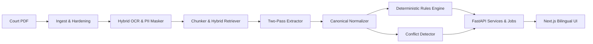

# Bilingual Case-Brief & Rule-Check Engine for Indian Courts

[](https://www.python.org/downloads/release/python-3110/)
[](https://fastapi.tiangolo.com/)
[](https://nextjs.org/)
[](LICENSE)
[](eval/run_eval.py)

> ⚖️ **Mandatory Disclaimer:**  
> **"AI-assisted summary. Verify against the source document."**  
> *"एआई-सहायता प्राप्त सारांश। मूल दस्तावेज़ से सत्यापन करें।"*  
> *This system is a judicial assistant; it never decides cases or issues legal rulings.*

---

## Overview

The **Court Brief Engine** is an end-to-end, production-grade bilingual (Hindi/English) decision-support system specifically designed for Indian courts (Revenue Courts, District Courts, and High Courts).

When a judicial officer or advocate uploads a court petition or order (in English, Hindi, or mixed Devanagari/Latin script), the engine automatically produces:
1. **Bilingual Case Brief**: Structured case metadata (case number, jurisdiction, parties, timeline, claims) with verbatim page citations and confidence scores.
2. **Deterministic Rule-Check Report**: Evaluation of statutory compliance (limitation periods, jurisdiction, mandatory affidavits) executed via deterministic code rules, **never** via unverified LLM generation.
3. **Cross-Document Conflict Detection**: Identification of contradictory dates, party name discrepancies, and status mismatches across petitions and counter-affidavits with side-by-side citations.
4. **Grounded Judicial Q&A**: Follow-up chat interface strictly grounded in the uploaded case record with verified page references and zero-hallucination refusals.
5. **Interactive 50/50 Split-Screen UI**: Next.js 14 judicial workspace featuring bidirectional citation jumping, real-time Hindi/English UI toggle, and user-correction modals.

---

## Architecture & Data Flow



### Complete 11-Phase Implementation

| Phase | Module | Key Capabilities | Status |
| :---: | :--- | :--- | :---: |
| **1** | **Skeleton & Schemas** | Pydantic canonical models, pipeline interfaces, rules skeleton | ✅ **Done** |
| **2** | **Eval Harness & Glossary** | Devanagari normalizer, synthetic PDF generator, CI gate | ✅ **Done** |
| **3** | **Ingest, OCR & PII** | OpenCV deskew/binarization, Tesseract, Fernet-encrypted PII masker | ✅ **Done** |
| **4** | **Chunking & Retrieval** | Section-aware chunker, BM25Okapi + Dense hybrid retriever (RRF $k=60$) | ✅ **Done** |
| **5** | **Field Extraction** | Two-pass extractor with verbatim Unicode NFKC citation verification | ✅ **Done** |
| **6** | **Normalization & Conflicts** | Concept ontology mapper, cross-document temporal & party conflict detector | ✅ **Done** |
| **7** | **Rules Engine** | Declarative AST rules evaluator, UP Revenue Code rules, CSV legal import | ✅ **Done** |
| **8** | **Backend API & Orchestration** | FastAPI async endpoints, 10-stage background job runner, audit logging | ✅ **Done** |
| **9** | **Judicial Web UI** | Next.js 14 + Tailwind split-screen viewer, citation jumper, bilingual context | ✅ **Done** |
| **10** | **Q&A Faithfulness & Security** | Untrusted data sanitizer, faithfulness benchmark, adversarial attack suite | ✅ **Done** |
| **11** | **Hardening & Deployment** | Multi-stage Docker, AWS Mumbai (`ap-south-1`) spec, operations runbook | ✅ **Done** |

---

## Quick Start (Development)

### 1. Prerequisites
- Python 3.11+
- Node.js 18+ (for frontend)
- Tesseract OCR (with `tessdata` including `hin` and `eng`)

### 2. Backend Setup
```bash
# Clone the repository
git clone https://github.com/organization/court-brief-engine.git
cd court-brief-engine

# Create virtual environment
python -m venv .venv
source .venv/bin/activate  # On Windows: .venv\Scripts\activate

# Install dependencies in editable mode
pip install -e ".[dev]"

# Configure environment
cp .env.example .env

# Run FastAPI backend server
uvicorn app.main:app --host 0.0.0.0 --port 8000 --reload
```

Backend API will be accessible at `http://localhost:8000`.  
Swagger documentation available at `http://localhost:8000/docs`.

### 3. Frontend Setup
```bash
cd frontend
npm install
npm run dev
```

Frontend application will be accessible at `http://localhost:3000`.

---

## Production Deployment (Docker Compose)

To spin up the entire production stack (FastAPI Backend, Next.js Frontend, PostgreSQL, Redis, and MinIO) with one command:

```bash
# Configure production secrets
cp .env.production.example .env.production
nano .env.production

# Build and start services
docker compose -f docker-compose.prod.yml up -d --build

# Check health
docker compose -f docker-compose.prod.yml ps
```

See [`docs/deployment.md`](docs/deployment.md) and [`deploy/aws-ecs-mumbai.md`](deploy/aws-ecs-mumbai.md) for detailed cloud architecture in AWS `ap-south-1` (Mumbai).

---

## Running Verification & Tests

### Run Unit & Integration Tests
```bash
pytest tests/unit/ tests/integration/ -v
```

### Run Linters & Type Checking
```bash
# Code style and formatting
ruff check .

# Static type checking
mypy app/ pipeline/ rules/ eval/
```

### Run CI Evaluation Gate
```bash
python eval/run_eval.py --ci-gate
```

---

## Documentation Index

- **[System Architecture & Design Principles](docs/architecture.md)**
- **[PhD Research Report & Technical Innovations](docs/system_report.md)**
- **[Production Operations & Deployment Runbook](docs/deployment.md)**
- **[AWS ap-south-1 (Mumbai) Deployment Specification](deploy/aws-ecs-mumbai.md)**
- **[Data Privacy & DPDPA 2023 Handling](docs/data-handling.md)**
- **[Security Architecture & Threat Model](docs/security.md)**
- **[Rules Authoring & Legal Verification](docs/rules-authoring.md)**
- **[Bilingual Glossary Authoring](docs/glossary-authoring.md)**
- **[Known Limitations](docs/known-limitations.md)**

---

## License

This project is licensed under the MIT License.
