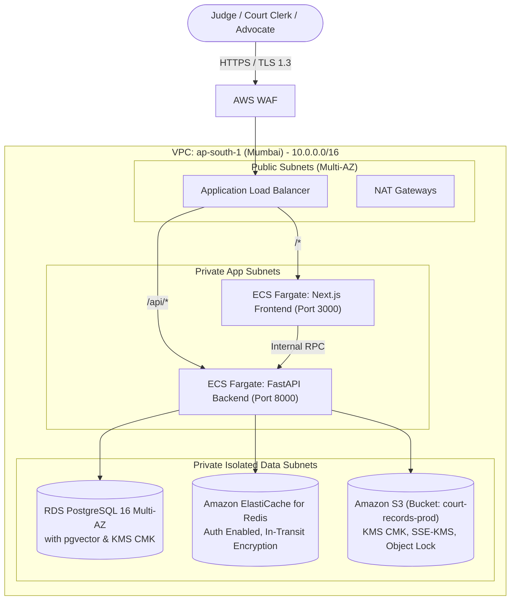

# Production Cloud Deployment Specification: AWS ap-south-1 (Mumbai)

## Regulatory & Data Sovereignty Context

Under India's **Digital Personal Data Protection Act (DPDPA 2023)** and Supreme Court of India e-Committee judicial IT guidelines:
1. **Data Sovereignty**: All judicial records, litigant identity data, FIR numbers, and court transcripts must remain strictly within sovereign Indian territory.
2. **Encryption Standards**: Data at rest must use AES-256 with KMS Customer Managed Keys (CMK) in the `ap-south-1` region. Data in transit requires TLS 1.3.
3. **PII Protection**: Reversible Fernet cryptographic keys for masked PII must be rotated periodically and stored in AWS Secrets Manager with restricted IAM roles.

---

## Architecture Topology



---

## Infrastructure Components

### 1. Networking & VPC
- **Region**: `ap-south-1` (Mumbai).
- **Subnets**:
  - 2 Public Subnets (for ALB and NAT Gateways across `ap-south-1a` and `ap-south-1b`).
  - 2 Private App Subnets (for ECS tasks, no public IPs).
  - 2 Private Isolated Data Subnets (for RDS, ElastiCache, no internet route).

### 2. Compute: AWS ECS Fargate
- **FastAPI Engine Task**:
  - CPU: 2 vCPU, Memory: 4 GB.
  - Autoscaling: Target 70% CPU utilization, minimum 2 tasks, maximum 10 tasks.
  - Image: Built from root `Dockerfile` and hosted in AWS ECR Mumbai repository.
- **Next.js Frontend Task**:
  - CPU: 1 vCPU, Memory: 2 GB.
  - Autoscaling: Target 70% CPU, minimum 2 tasks, maximum 6 tasks.
  - Image: Built from `frontend/Dockerfile`.

### 3. Database: Amazon RDS for PostgreSQL
- Engine: PostgreSQL 16.2.
- Multi-AZ deployment across availability zones `ap-south-1a` and `ap-south-1b`.
- Instance Class: `db.r6g.large` (Memory optimized for vector similarity search).
- Storage: 100 GB gp3 with auto-expansion up to 1 TB.
- Encryption: Enabled using AWS KMS Customer Managed Key.

### 4. Object Storage: Amazon S3
- Bucket: `indian-court-records-prod-mumbai`.
- Default Encryption: `aws:kms` with CMK.
- Public Access: Block All Public Access enabled.
- Versioning: Enabled with Object Lock for tamper-evident retention of original court petitions.

### 5. Secrets Management
- AWS Secrets Manager stores:
  - `PII_ENCRYPTION_KEY`
  - `SECRET_KEY`
  - `DATABASE_URL`
  - `GEMINI_API_KEY`
- Injected into ECS container task definitions via IAM execution roles at startup.

---

## CI/CD Pipeline (GitHub Actions to ECR & ECS)

```yaml
# .github/workflows/deploy-prod.yml
name: Deploy Production to AWS Mumbai
on:
  push:
    tags:
      - 'v*.*.*'

jobs:
  deploy:
    runs-on: ubuntu-latest
    steps:
      - uses: actions/checkout@v4
      - name: Configure AWS Credentials
        uses: aws-actions/configure-aws-credentials@v4
        with:
          aws-region: ap-south-1
          role-to-assume: arn:aws:iam::ACCOUNT_ID:role/CourtBriefDeployerRole
      - name: Run CI Gate
        run: |
          pip install -e ".[dev]"
          python eval/run_eval.py --ci-gate
      - name: Login to Amazon ECR
        id: login-ecr
        uses: aws-actions/amazon-ecr-login@v2
      - name: Build, tag, and push images
        run: |
          docker build -t $ECR_REGISTRY/court-backend:${{ github.ref_name }} .
          docker build -t $ECR_REGISTRY/court-frontend:${{ github.ref_name }} ./frontend
          docker push $ECR_REGISTRY/court-backend:${{ github.ref_name }}
          docker push $ECR_REGISTRY/court-frontend:${{ github.ref_name }}
      - name: Deploy to Amazon ECS
        run: |
          aws ecs update-service --cluster court-prod-cluster --service court-backend-service --force-new-deployment
          aws ecs update-service --cluster court-prod-cluster --service court-frontend-service --force-new-deployment
```
